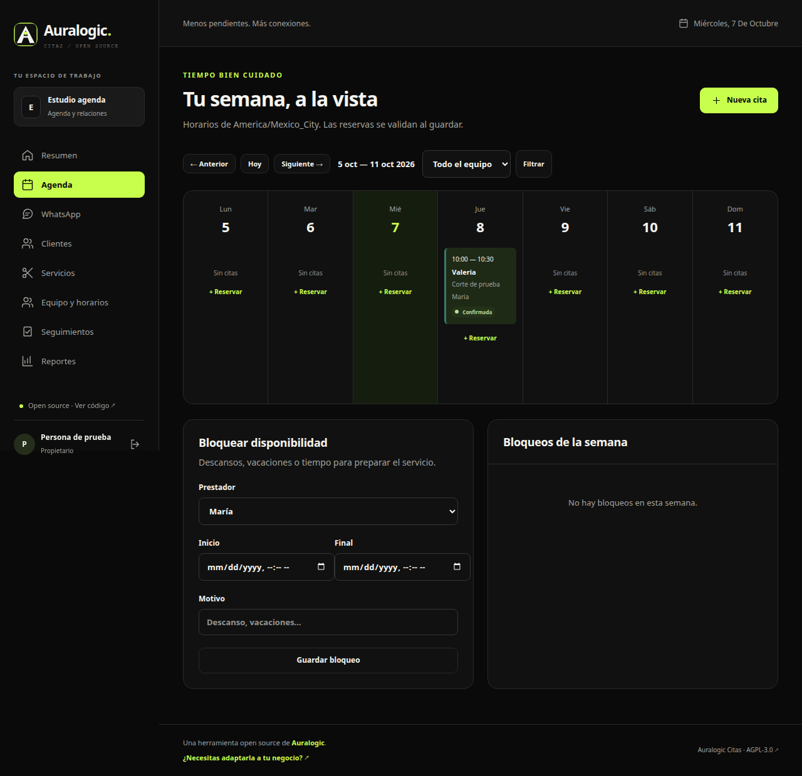

# Auralogic Citas

[](https://github.com/Traka-Dev/auralogic-citas/actions/workflows/ci.yml)
[](LICENSE)
[](https://auralogic.dev/)

**Una herramienta open source de [Auralogic](https://auralogic.dev/)** para convertir consultas de WhatsApp en citas y dar seguimiento a los clientes. Instálala en tu propio servidor y adapta el código a tu negocio.

CRM open source para negocios con citas. Construido con **Astro, TypeScript y SQLite**, con una bandeja experimental de WhatsApp Web mediante un worker independiente.

La primera versión está enfocada en salones, barberías y servicios que reservan un prestador por cita. Es una base funcional para pilotos, con un alcance explícito y herramientas para colaborar.

**English:** Auralogic Citas is a self-hosted, open-source appointment CRM built with Astro, TypeScript and SQLite. It includes tenant isolation, customer records, staff availability, transactional booking and an experimental WhatsApp Web connector. Contributions in English and Spanish are welcome.



## Auralogic y esta herramienta

[Auralogic](https://auralogic.dev/) crea webs, automatizaciones y herramientas para negocios. Este proyecto forma parte de sus herramientas abiertas: puedes revisar el código, probarlo y contribuir sin contratar servicios.

Si necesitas instalación, integraciones o una adaptación para tu operación, [cuéntanos tu proyecto](https://auralogic.dev/es/?utm_source=auralogic-citas&utm_medium=github&utm_campaign=tools#contact). El contacto comercial es opcional y no se requiere para descargar ni usar el proyecto.

La app incluye atribución visible a Auralogic y enlaces al estudio. Los enlaces de contacto usan parámetros UTM para identificar su origen; no se añade analítica ni se transmiten datos del CRM al estudio. El uso de la marca se explica en [docs/BRANDING.md](docs/BRANDING.md).

## Qué funciona

- Registro de negocios, inicio de sesión y sesiones persistidas con cookies HttpOnly.
- Aislamiento entre negocios, roles de propietario, administrador y agente, invitaciones y cambio de negocio.
- Clientes con búsqueda, etiquetas, edición, archivo, notas internas e historial de citas.
- Servicios con precio, duración y tiempo entre citas; prestadores y servicios habilitados.
- Horarios semanales, excepciones mediante bloqueos y agenda por semana.
- Reservas transaccionales, confirmación, reprogramación, cancelación, asistencia y ausencias.
- Seguimientos internos, cobros registrados manualmente y reportes de asistencia.
- Worker de WhatsApp: QR, credenciales cifradas, mensajes de texto entrantes/salientes, asignación de conversaciones y detección de desconexión.
- Diseño adaptable al móvil, formularios HTML y renderizado en servidor.

**Fuera de esta versión:** descarga/envío de adjuntos, importación del historial anterior de WhatsApp, Cloud API, campañas, recordatorios automáticos, enlaces públicos de reserva, cobros electrónicos y suscripciones. Los adjuntos recibidos se señalan para consultarlos en WhatsApp. Consulta [el roadmap](docs/ROADMAP.md).

## Desarrollo local

Requisitos: Node.js **24**, npm y Git. No necesitas una cuenta externa ni conectar WhatsApp para usar la agenda.

```bash
git clone https://github.com/Traka-Dev/auralogic-citas.git
cd auralogic-citas
npm ci
cp .env.example .env
npm run db:migrate
npm run dev
```

Abre **http://localhost:4321/registro**, crea tu negocio y configura servicios → prestadores → horarios → clientes → primera cita. El servidor escucha en la interfaz local. La base de datos se crea en `data/auralogic-citas.sqlite`, excluida de Git.

En Windows puedes copiar `.env.example` a `.env` con tu editor o `Copy-Item .env.example .env` en PowerShell.

### Demostración opcional

En `.env`, define `SEED_EMAIL` y una `SEED_PASSWORD` propia de al menos 12 caracteres; después ejecuta:

```bash
npm run db:seed
```

Esto crea Estudio Oliva con contactos ficticios, servicios y citas. El seed no modifica cuentas existentes ni conecta WhatsApp. No hay una contraseña de demostración predeterminada.

### WhatsApp experimental

Consulta [docs/WHATSAPP.md](docs/WHATSAPP.md) para generar la clave y ejecutar el worker. El CRM funciona sin ese proceso. Es una integración **no oficial**: no ofrece garantías de continuidad o ausencia de bloqueos. La prueba completa necesita vincular un número real; las pruebas automáticas no se conectan a WhatsApp.

## Comprobaciones

```bash
npm run verify
npx playwright install chromium
npm run test:e2e
```

`verify` ejecuta tipos, lint, formato, pruebas de dominio y build. Los E2E levantan un servidor y una base aislados en el puerto 4322; no utilizan tus datos. En Linux puedes necesitar `npx playwright install --with-deps chromium`.

## Producción y Docker

```bash
npm run build
npm start
```

Configura `APP_ORIGIN` con el origen público exacto (sin barra final), `HOST`, `PORT` y una ruta persistente para `DATABASE_PATH`. No uses el servidor de desarrollo públicamente. [La guía de despliegue](docs/DEPLOYMENT.md) incluye Docker Compose, HTTPS y copias de seguridad.

SQLite permite empezar con un despliegue pequeño sobre disco local. Esta versión no soporta réplicas sobre bases SQLite independientes ni varios workers de WhatsApp. PostgreSQL y colas distribuidas quedan en el roadmap.

## Colaborar

Lee [CONTRIBUTING.md](CONTRIBUTING.md), [CODE_OF_CONDUCT.md](CODE_OF_CONDUCT.md) y [la arquitectura](docs/ARCHITECTURE.md). Hay plantillas de issues y PR, CI, Dependabot y una lista de tareas iniciales para contribuidores en [docs/ROADMAP.md](docs/ROADMAP.md).

### Reglas de contribución

1. Haz un fork y crea una rama desde `main` para cada cambio.
2. Mantén Astro y TypeScript; valida datos y permisos en el servidor y conserva el aislamiento por negocio.
3. No incluyas credenciales, QR, sesiones, bases de datos ni información real de clientes.
4. Añade pruebas cuando cambien reservas, permisos, persistencia o integración; documenta las migraciones.
5. Ejecuta `npm run verify` y los E2E correspondientes; describe el resultado en el PR.
6. Firma tus commits con DCO (`git commit -s`) y acepta AGPL-3.0-only para el código aportado.
7. Mantén un trato respetuoso y reporta vulnerabilidades por el [canal privado](https://github.com/Traka-Dev/auralogic-citas/security/advisories/new).

Consulta [las instrucciones completas](CONTRIBUTING.md), [issues](https://github.com/Traka-Dev/auralogic-citas/issues) y [el roadmap](docs/ROADMAP.md) para encontrar tareas. La publicación y los ajustes de GitHub se documentan en [docs/MAINTAINERS.md](docs/MAINTAINERS.md).

## Licencia

**AGPL-3.0-only**, elegida para que las mejoras distribuidas o puestas a disposición por red mantengan las obligaciones de compartir su código correspondiente según la licencia. Consulta [LICENSE](LICENSE). Las dependencias conservan sus propias licencias. Este proyecto no está afiliado con WhatsApp ni Meta.
