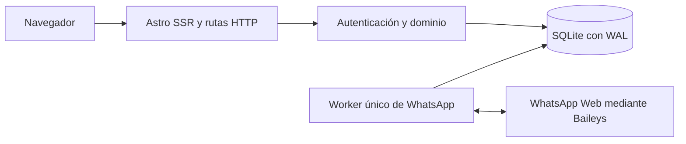

# Arquitectura

Astro sirve HTML por solicitud con el adaptador Node en modo standalone. La UI usa componentes `.astro` y CSS; JavaScript pequeño filtra prestadores compatibles y actualiza el chat. No hay Next.js ni una SPA que deba hidratarse completa.

## Organización

| Directorio         | Responsabilidad                          |
| ------------------ | ---------------------------------------- |
| `src/pages`        | Pantallas y endpoints                    |
| `src/components`   | UI compartida y formularios              |
| `src/layouts`      | Navegación y estructura                  |
| `src/lib/auth.ts`  | Usuarios, sesiones, roles y límites      |
| `src/lib/crm.ts`   | Clientes, servicios y agenda             |
| `src/lib/db.ts`    | Acceso SQLite y migraciones versionadas  |
| `src/lib/whatsapp` | Cifrado, estado del conector e ingestión |
| `scripts`          | Migración, seed y worker                 |
| `tests`            | Dominio, concurrencia y navegador        |

## Aislamiento y permisos

El contexto de sesión determina el negocio. Las solicitudes no pueden elegir arbitrariamente `business_id`; el cambio de negocio verifica membresía y rota la sesión. Las tablas dependientes usan claves foráneas compuestas para impedir relaciones entre empresas.

Los agentes atienden y reservan dentro de la bandeja compartida. Los administradores y propietarios configuran servicios, personal, horarios, invitaciones y cobros. Los reportes requieren administración. Un prestador es un recurso de agenda, no una cuenta de acceso.

## Reservas

Una transacción `BEGIN IMMEDIATE` comprueba cliente, servicio, prestador, habilitación, horario semanal, bloqueos y solapamientos. Inserta la reserva antes de confirmar la transacción. Dos procesos que soliciten el mismo intervalo no pueden reservarlo simultáneamente. Un test inicia dos procesos reales sobre el mismo archivo SQLite.

La zona horaria pertenece al negocio; Luxon convierte a UTC y rechaza horas inexistentes o ambiguas. La ocupación incluye el tiempo entre servicios. Reprogramar conserva el precio vigente del servicio como nuevo precio acordado y vuelve a estado pendiente; si falla, conserva la reserva anterior.

## WhatsApp

El worker y Astro comparten SQLite sobre disco local. Un lease renovable impide workers duplicados. El QR y las credenciales se cifran con una clave fuera de la base. El worker guarda eventos entrantes de forma idempotente y procesa mensajes salientes de la cola persistida.

La UI consulta el estado cada cuatro segundos. No se usa Redis todavía: la cola SQLite sirve al despliegue inicial. Los envíos que pueden haber llegado sin confirmación se marcan como inciertos y no se repiten solos. No hay garantía de entrega exactamente una vez.

## Límites

Un archivo SQLite sobre disco local y un worker por instalación. El listado de clientes devuelve hasta 200 resultados; chat y conversaciones hasta 100, sin paginación todavía. La disponibilidad tiene un intervalo por día; descansos se representan con bloqueos. Los reportes usan el estado actual de cada cita, no reconstrucción histórica del embudo.

Para escalar: repositorios PostgreSQL, cola distribuida, almacenamiento de adjuntos y política explícita de acceso a conversaciones. Mantener las reglas del dominio y las pruebas de aislamiento al migrar.
